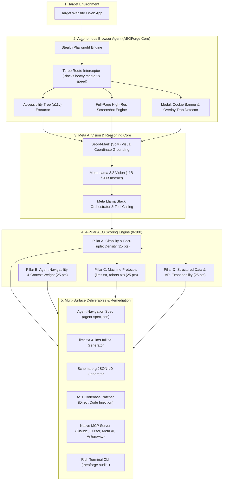

# AEOForge ⚡
### Autonomous Meta AI Agent for Web Agent-Readiness, AEO Auditing, Visual Grounding & Self-Healing Navigation Specs
**Built for the Meta Global AI Developer Hackathon 2026 ($1,000,000 Prize Pool)**

<div align="center">

[](https://opensource.org/licenses/MIT)
[](https://www.python.org/)
[](https://ai.meta.com/llama/)
[](https://github.com/meta-llama/llama-stack)
[](https://playwright.dev)
[](https://modelcontextprotocol.io)
[](https://llmstxt.org)

<br />

**The Open-Source "Lighthouse for AI Agents & Answer Engines".**  
*Audits any website for Answer Engine Optimization (AEO) and Agent-Readiness, visually grounds interactive affordances with Meta Llama 3.2 Vision, detects agent navigation traps, and generates machine-executable Navigation Specs (`agent-spec.json`) and compliant `llms.txt`.*

[System Architecture](#-system-architecture) • [Why AEOForge?](#-why-aeoforge-vs-traditional-seo) • [Meta AI Integration](#-meta-ai--llama-stack-integration) • [The 4 AEO Pillars](#-the-4-pillar-aeo--agent-readiness-framework) • [Agent Navigation Spec](#-the-machine-to-machine-handshake-agent-specjson) • [Quickstart Guide](#-quickstart-guide)

</div>

---

## 📌 Executive Overview & Enterprise Problem Statement

The internet was built exclusively for **human eyeballs**: heavy visual DOM trees (50,000+ tokens per page), JavaScript SPAs, cookie consent walls, shadow DOMs, non-semantic buttons, and dynamic re-renders.

With the historic shift toward **Answer Engines** (Meta AI, Perplexity, ChatGPT Search, Google AI Overviews) and **Autonomous Browser Agents** (Meta AI agents, Claude Computer Use, browser-use), websites face an existential problem:
1. **Agent Blindness & Navigation Traps**: Autonomous agents burn millions of tokens trying to navigate raw HTML. Intrusive cookie consent overlays, sticky headers, and unlabelled interactive elements trap agents into infinite loops.
2. **Missing AEO (Answer Engine Optimization)**: Over 95% of web pages lack structured fact-triplets (`<Subject, Predicate, Object>`), machine-readable `llms.txt` directories, and Schema.org entity graphs. When Meta AI or Perplexity queries the web, unoptimized sites are ignored or hallucinated.
3. **No Machine-to-Machine Handshake**: When an AI agent reaches a website, there is no machine-readable manifest explaining how to query, scrape, or interact with that site reliably with minimal token cost.

**AEOForge** solves this crisis. Acting as an autonomous **Meta AI Web Auditor**, it navigates target websites using local headless vision + accessibility tree inspection, calculates an objective **0–100 AEO & Agent-Readiness Score**, flags agent navigation traps, generates a machine-executable **Agent Navigation Spec (`agent-spec.json`)**, and auto-produces spec-compliant `llms.txt` and Schema.org patches.

---

## 💡 Why AEOForge? (vs. Traditional SEO)

| Dimension | Traditional SEO (Google 2010–2024) | AEO & Agentic Web (Meta AI / 2026+) | AEOForge ⚡ |
| :--- | :--- | :--- | :--- |
| **Primary Audience** | Human searchers clicking blue links | Autonomous AI agents & Answer Engines | **Agents & Answer Engines** |
| **Core Metric** | Keywords, backlinks, CTR | Fact-triplets, citation potential, token efficiency | **0–100 AEO & Agent Score** |
| **Navigation Medium**| Browser DOM rendered for eyes | Accessibility Tree (a11y) & Visual Grounding | **Set-of-Mark (SoM) + a11y Tree** |
| **Agent Traps** | Ignored (humans can click "X") | Lethal (causes agent timeouts & context exhaustion) | **Automated Blocker & Trap Detection** |
| **Machine Discovery**| `sitemap.xml`, `robots.txt` | `llms.txt`, `llms-full.txt`, WebMCP endpoints | **Spec-Compliant Auto-Generation** |
| **Agent Instructions**| None (agents must guess) | Structured action map & endpoint manifest | **`agent-spec.json` Handshake** |
| **Model Technology** | Static regex & rule engines | **Meta Llama 3.2 11B/90B Vision + Llama Stack** | **Native Meta AI Integration** |

---

## 🏗️ System Architecture



---

## 🤖 Meta AI & Llama Stack Integration

AEOForge is built natively for the **Meta Global AI Developer Hackathon 2026** under the **Push the Frontier** and **Indie Developer** tracks:

1. **Meta Llama 3.2 Vision (11B & 90B Instruct)**:
   - Evaluates high-resolution screenshots tagged with **Set-of-Mark (SoM)** numerical bounding boxes.
   - Detects visual obstructions that confuse AI agents (e.g., non-standard consent popups, sticky navigation bars obscuring submit buttons, infinite-scroll layout shifts).
   - Extracts structured facts and inverted pyramid answers directly from complex visual sections (infographics, tables, pricing matrices).
2. **Meta Llama Stack (`llama-stack`)**:
   - Manages the agent reasoning loop, tool execution (browser navigation, HTML parsing, DNS verification), and local/remote inference switching.
   - Supports both the **Meta Model API** (cloud inference) and local execution via Ollama/vLLM for 100% private, self-hosted web auditing.

---

## 📊 The 4-Pillar AEO & Agent-Readiness Framework

AEOForge scores every web page from **0 to 100 points** across four critical pillars:

### 1. Pillar A: Citability & Answerability (25 Points)
- **Fact-Triplet Density**: Evaluates whether sentences express unambiguous `<Subject, Predicate, Object>` assertions.
- **Direct Definition Blocks**: Checks for 40–60 word answer capsules placed directly below `H2`/`H3` heading queries.
- **E-E-A-T Signals**: Verifies explicit author credentials, publication timestamps, and verified citation sources.

### 2. Pillar B: Agent Navigability & Token Cost (25 Points)
- **DOM-to-Content Ratio**: Penalizes pages with >25,000 tokens of raw HTML yielding <500 tokens of actual text.
- **Accessibility (a11y) Landmarks**: Audits `<main>`, `<article>`, `<nav>`, and ARIA roles for clear agent traversal.
- **Interactive Affordance Clarity**: Flags clickable `div` elements lacking keyboard focus or descriptive labels.
- **Modal Trap Detection**: Flags unclosable cookie banners or lightbox overlays that break autonomous agents.

### 3. Pillar C: Machine Discovery & Protocols (25 Points)
- **`llms.txt` & `llms-full.txt` Conformance**: Checks for spec-compliant markdown navigation files at the domain root.
- **AI Crawler Permissions**: Audits `robots.txt` for explicit policies regarding `Meta-ExternalAgent`, `GPTBot`, `ClaudeBot`, and `PerplexityBot`.
- **IndexNow Integration**: Verifies instant search indexing protocols.

### 4. Pillar D: Structured Data & API Exposeability (25 Points)
- **Schema.org JSON-LD**: Validates semantic graph completeness (`Organization`, `Article`, `FAQPage`, `WebSite`).
- **Hidden API & Feed Discovery**: Detects exposed JSON endpoints, RSS/Atom feeds, or OpenAPI specs that allow agents to bypass scraping entirely.

---

## 🤝 The Machine-to-Machine Handshake (`agent-spec.json`)

When AEOForge completes an audit, it emits a standardized **Agent Navigation Spec**. Any visiting AI agent can consume this JSON file to navigate and extract data from the site with **90% fewer tokens**:

```json
{
  "$schema": "https://aeoforge.dev/schemas/agent-spec-v1.json",
  "domain": "example.com",
  "generated_at": "2026-11-03T22:30:00Z",
  "aeo_score": 88,
  "agent_instructions": {
    "recommended_mode": "accessibility_tree",
    "primary_content_selector": "main#content",
    "token_budget_estimate": 1840,
    "known_navigation_traps": [
      {
        "type": "cookie_banner",
        "dismiss_selector": "button#accept-all-cookies",
        "action": "click"
      }
    ],
    "action_map": {
      "search": {
        "endpoint": "/api/search?q={query}",
        "fallback_selector": "input[type='search']"
      },
      "pagination": {
        "next_button": "a[rel='next']",
        "pattern": "?page={n}"
      }
    },
    "direct_api_alternatives": [
      {
        "description": "Public product catalog JSON API",
        "url": "/api/v1/products",
        "auth_required": false
      }
    ]
  }
}
```

---

## 💎 Hidden Gems & Open-Source Engineering DNA

AEOForge integrates algorithmic breakthroughs from the best open-source projects:

* **From [`Aryanban/leadforge`](https://github.com/Aryanban/leadforge)**:
  - **Turbo Route Interception**: Drops images, fonts, and tracking scripts to speed up browser crawls by 3x–5x.
  - **Cloudflare XOR Deobfuscator**: Automatically decodes `data-cfemail` ciphers.
* **From [`Aryanban/seoforge`](https://github.com/Aryanban/seoforge)**:
  - **BFS Crawler & PageRank Graph**: Discovers high-authority internal hubs.
  - **AST Code Patcher**: Automatically injects generated `llms.txt` and JSON-LD into client projects.
* **From [`browser-use/browser-use`](https://github.com/browser-use/browser-use)**:
  - **Set-of-Mark (SoM) Coordinate Grounding**: Tags interactable elements with numeric visual badges for VLM reasoning.
* **From [`browserbase/stagehand`](https://github.com/browserbase/stagehand)**:
  - **Candidate Element Pruning**: Strips useless DOM nodes, keeping context within strict token budgets.
* **From [`microsoft/OmniParser`](https://github.com/microsoft/OmniParser)**:
  - **Vision-First Icon & Element Grounding**: Eliminates brittle CSS/XPath selector dependencies.
* **From [`strattlabs/llms-txt-kit`](https://github.com/strattlabs/llms-txt-kit)**:
  - **Spec-Compliant Linter**: Ensures generated `llms.txt` conforms 100% to the official `llmstxt.org` specification.

---

## 🚀 Zero-Friction Quickstart Guide

### 1. The Single-Instruction Automated Setup (`setup.sh`)

You do **not** need to install or configure packages manually. Run the automated setup script to verify Python, create the `.venv`, install all dependencies, configure Playwright Chromium, and check Ollama in one shot:

```bash
# Clone the repository
git clone https://github.com/Aryanban/aeoforge.git
cd aeoforge

# ⚡ Single-command setup (automated installation & verification)
./setup.sh

# 🚀 Launch the Web UI & REST API server immediately on http://localhost:8000
./setup.sh --start
```

---

## 💻 Running 100% Locally on a 16GB Laptop

AEOForge is engineered for **100% Local Sovereignty**. You do **not** need external cloud subscriptions or paid API keys. Everything runs comfortably on a standard developer machine (such as a 16GB Apple Silicon Mac or PC):

1. **Local Vision & Reasoning (Meta Llama 3.2 via Ollama)**:
   ```bash
   # Install Ollama (macOS: brew install ollama)
   ollama serve
   ollama pull llama3.2       # Compact 3.2B parameter model (ultra-fast, ~2.0 GB VRAM)
   # Or for multimodal vision:
   ollama pull llama3.2-vision
   ```
   AEOForge automatically probes `http://127.0.0.1:11434` on launch. When detected, all citability verification, inverted-pyramid answering, and affordance reasoning execute directly on your local GPU/Metal.

2. **Local Headless Playwright Navigator**:
   Browser rendering, Set-of-Mark (SoM) bounding box extraction, and accessibility tree parsing run locally inside headless Chromium with zero cloud egress.

3. **Local SQLite Persistent Storage**:
   Audits, historical domain progressions (`+X pts`), technical preferences, and codebase patch logs are preserved in WAL mode at `data/aeoforge.db`.

4. **Self-Healing AST Codebase Patcher**:
   Injects generated `llms.txt` and Schema.org JSON-LD directly into client projects on your local filesystem with atomic rollback safety.

---

## 🏆 How to Present AEOForge to Viewers & Judges

When pitching or demonstrating AEOForge, follow this proven **3-Minute Hackathon Demo Narrative**:

```
1. THE CRISIS (0:00 - 0:45)
   "The web was engineered for human retinas. But today, the web is browsed by autonomous
    AI agents and Answer Engines (Meta AI, Perplexity, ChatGPT Search, Claude Computer Use).
    Over 95% of websites fail agent interaction: they burn 50,000 tokens of DOM bloat,
    trap agents behind modal walls, lack /llms.txt, and have zero Schema.org entity graphs.
    When an AI searches the web, unoptimized websites are simply ignored."

2. THE SOLUTION (0:45 - 1:45)
   "AEOForge is the open-source 'Lighthouse for the Agentic Web'. Powered by Meta Llama 3.2
    and Playwright, it executes an autonomous 4-Pillar audit in seconds:
    • Pillar A (Citability): Measures fact-triplet density and inverted-pyramid capsules.
    • Pillar B (Navigability): Audits accessibility landmarks and detects agent traps.
    • Pillar C (Machine Protocols): Verifies spec-compliant /llms.txt and crawler policies.
    • Pillar D (Structured Data): Validates semantic graphs and hidden API endpoints."

3. THE LIVE DEMO & IMPACT (1:45 - 3:00)
   "Show the Web UI at http://localhost:8000:
    1. Enter target URL (e.g., https://dholeramap.com) and click 'Audit Website'.
    2. Inspect the Live Scorecard (66/100 Grade C) and Visual Affordance Grounding (SoM).
    3. Show the Competitor Comparison Lab (side-by-side agent readiness).
    4. Click 'Apply Fix to Codebase' — our AST patcher injects compliant llms.txt & JSON-LD!
    5. Check the Persistent Progression Drawer (⌘H) showing the historical +18 pts jump."
```

---

## 🔍 Real-World Case Study: Auditing `dholeramap.com`

During testing, AEOForge conducted an autonomous audit on **`https://dholeramap.com/`**. Here is the exact breakdown of the findings and what they reveal:

```
Target URL: https://dholeramap.com/
Overall AEO Score: 66.0 / 100 (Grade C — Needs Optimization)
```

### 1. Pillar Scores & Diagnostic Insights
* **Pillar A: Citability & Answerability (12.0 / 25)**:
  - *Finding*: Fact density is **6.5%**. While the page contains an optimal 35–65 word definition block directly under an `H2` heading, it lacks explicit author credentials and verified publication timestamps (E-E-A-T). Answer engines struggle to attribute authority to unsigned claims.
* **Pillar B: Agent Navigability & Token Cost (17.5 / 25)**:
  - *Finding*: Token ratio is **4.23%** (heavy text-to-DOM bloat). The raw HTML contains ~25,000 tokens of markup yielding only a fraction of readable content.
  - *Strength*: **0 Navigation Traps**. The site is clean of intrusive popups, and 100% of interactive elements possess valid accessibility names.
* **Pillar C: Machine Protocols & Discovery (19.0 / 25)**:
  - *Strength*: A valid `/llms.txt` file was detected at the domain root!
  - *Critical Blocker*: Its `robots.txt` actively disallows web crawlers, inadvertently preventing AI answer engines (`Meta-ExternalAgent`, `PerplexityBot`) from indexing the content.
* **Pillar D: Structured Data & API Exposeability (17.5 / 25)**:
  - *Critical Blocker*: Zero Schema.org JSON-LD graphs found. Without `WebSite`, `Organization`, or `Place` schemas, knowledge graphs cannot form entity triples.

### 2. Actionable Remediation Plan
1. Update `robots.txt` to permit official AI agent bots (`Meta-ExternalAgent`, `ClaudeBot`, `PerplexityBot`).
2. Run `aeoforge patch` to inject structured `Organization` and `Place` Schema.org JSON-LD.
3. Add signed author capsules and publication dates to elevate E-E-A-T signals.

---

## 🤖 For Autonomous Coding Agents (`AGENTS.md`)

If you are using an AI coding agent (**Cursor**, **Windsurf**, **Claude Code**, **Antigravity**, **Copilot Workspace**), refer to [`AGENTS.md`](AGENTS.md). It outlines:
- Complete directory architecture and file responsibilities.
- REST API endpoint catalog (`/api/v1/tools`).
- Programmatic CLI commands with `--json` outputs.
- MCP Server setup instructions.
- Development and `/ponytail` minimal-diff guidelines.

---

## 🚀 Manual CLI & API Quickstart

### 2. Environment Setup (Tri-Mode Inference)

AEOForge is built to run anywhere — locally or via cloud APIs:

* **Mode A: 100% Local On-Device (Zero API Keys)**
  ```bash
  # Pull Meta's vision model locally via Ollama
  ollama run llama3.2-vision
  # AEOForge auto-detects Ollama at http://localhost:11434 and runs 100% privately on your machine!
  ```

* **Mode B: Cloud Meta Model API ($150 Hackathon Credits)**
  ```bash
  cp .env.example .env
  # Set your META_MODEL_API_KEY in .env
  ```

* **Mode C: Zero-Config Local Heuristics**
  ```bash
  # No API keys or Ollama needed! Built-in deterministic DOM/a11y engine runs immediately.
  ```

### 3. Run Your First AEO Audit via CLI

```bash
# Run a full visual + AEO audit on any URL (with interactive HTML dashboard)
aeoforge audit https://example.com --html report.html

# Run a multi-page crawl of internal links with sitewide score
aeoforge audit https://example.com --crawl --max-pages 5

# Generate machine-readable agent-spec.json and llms.txt
aeoforge spec https://example.com --out-dir ./output

# Automatically patch local project with missing llms.txt & JSON-LD
aeoforge patch --target-dir ./my-website-project
```

### 4. Run the REST API Server & UI

```bash
aeoforge serve --port 8000
# API documentation available at: http://localhost:8000/docs
```

---

## 🤖 Universal Model Context Protocol (MCP) Setup

AEOForge includes a native MCP server so external AI agents (**Meta AI**, **Claude**, **Cursor**, **Antigravity**) can audit websites autonomously:

Add to your MCP configuration (`claude_desktop_config.json`, `~/.gemini/antigravity/mcp_config.json`, or `.cursor/mcp.json`):

```json
{
  "mcpServers": {
    "aeoforge": {
      "command": "python",
      "args": ["-m", "aeoforge.mcp_server"]
    }
  }
}
```

### Available Native MCP Tools:
* `aeoforge_audit`: Computes full 0–100 AEO score, identifies navigation blockers, and returns detailed diagnostics.
* `aeoforge_generate_spec`: Synthesizes `agent-spec.json` and `llms.txt` for any target URL.
* `aeoforge_verify_citability`: Evaluates text passages for AI answer engine citation potential and fact-triplets.
* `aeoforge_detect_traps`: Navigates a page and identifies popup blockers, cookie consent modals, and unlabelled interactive affordances.

---

## 🧪 Testing & Verification

Run the test suite with `pytest`:

```bash
pytest -v
```

---

## 📜 License

Distributed under the **MIT License**. See [`LICENSE`](LICENSE) for details.

Copyright © 2026 Aryan Bansal. Built with pride for the Meta Global AI Developer Hackathon 2026.
