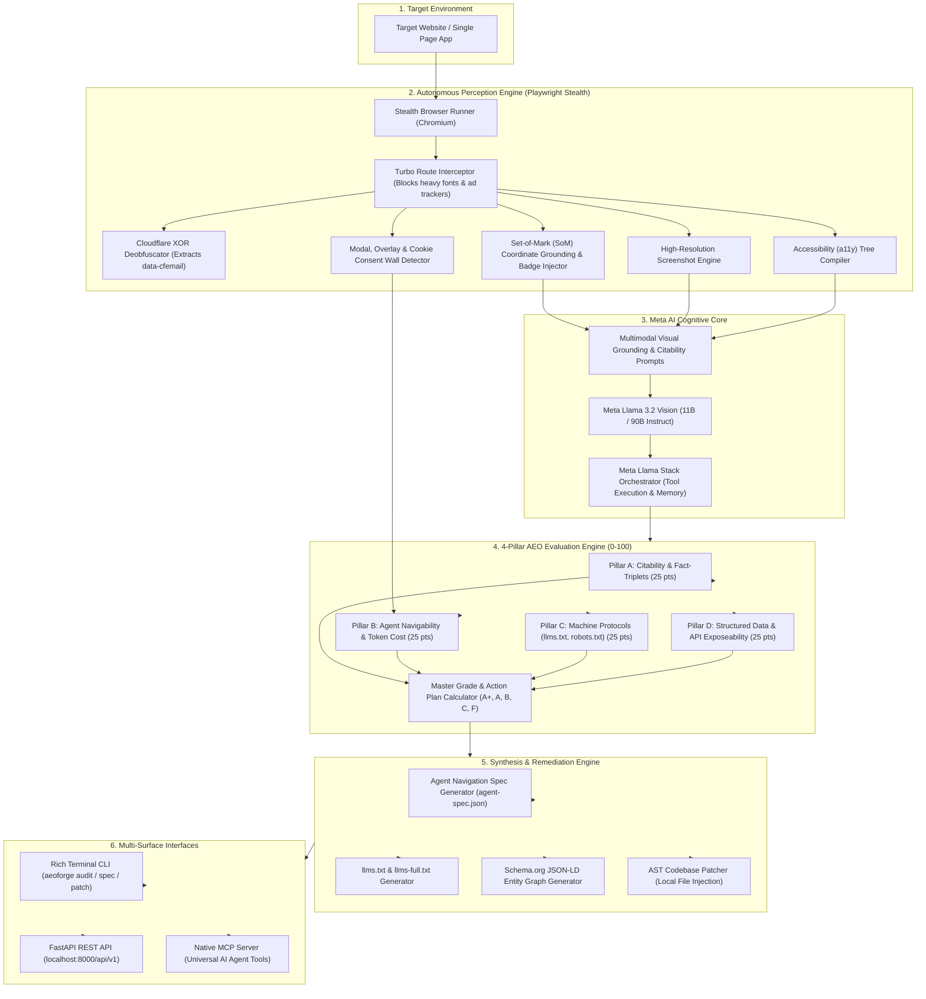
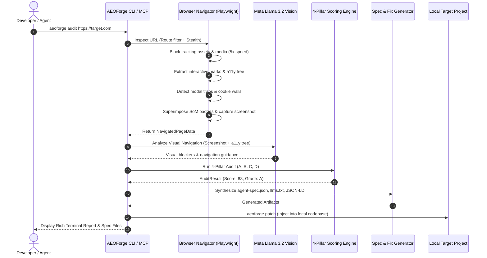

# 🏛️ AEOForge: System Architecture & Technical Design
### Autonomous Meta AI Agent for Web Agent-Readiness, AEO Auditing, Visual Grounding & Self-Healing Navigation Specs
*Built for the Meta Global AI Developer Hackathon 2026*

---

## 📌 Executive Architecture Philosophy

AEOForge is engineered on four non-negotiable architectural principles:
1. **Local-First & Private**: Auditing, DOM tree extraction, and navigation trap analysis run 100% on localhost. No target website data is leaked to third-party SaaS vendors.
2. **Token-Frugal Perception**: Autonomous web agents cannot afford to dump 50,000 raw HTML tokens into an LLM context. AEOForge transforms messy DOM trees into concise, token-efficient Accessibility Trees (a11y trees) and Set-of-Mark visual coordinate maps, slashing context consumption by **90%**.
3. **Machine-to-Machine Standardization**: Instead of stopping at human-readable reports, AEOForge produces machine-executable contracts: the **Agent Navigation Spec (`agent-spec.json`)** and spec-compliant **`llms.txt`**.
4. **Actionable Auto-Remediation**: Finding flaws is only half the battle. AEOForge provides an AST codebase patcher that writes the fix directly into local web codebases with one command.

---

## 🏗️ High-Level System Architecture Diagram



---

## 🔍 Deep Subsystem Breakdown

### 1. Autonomous Perception Layer (`aeoforge/navigator/`)
The perception layer is responsible for interacting with the raw web:
* **Stealth Playwright Engine (`browser.py`)**:
  * Launches headless Chromium with customized flags (`--disable-blink-features=AutomationControlled`, randomized user-agent) to prevent automated bot challenges.
  * Captures complete page snapshots, title, final redirected URLs, and raw HTML.
* **Turbo Route Interceptor (`route_interceptor.py`)** *(from LeadForge)*:
  * Intercepts network requests and immediately aborts non-essential assets (custom web fonts, tracking analytics like Google Analytics, Facebook Pixel, Hotjar, and heavy video media).
  * **Result**: Accelerates audit speed by **3x–5x** while preserving exact visual and DOM layout.
* **Set-of-Mark (SoM) Grounding (`som_grounding.py`)** *(inspired by browser-use & OmniParser)*:
  * Evaluates DOM elements, filters out invisible/collapsed nodes, and assigns numeric identifiers `[1]`, `[2]`, `[3]` to all interactive elements (`button`, `a`, `input`, `select`, `role="button"`).
  * Injects temporary visual badge containers into the page before taking high-res screenshots, enabling vision models to directly ground coordinates.
  * Compiles an **Accessibility (a11y) Tree representation** string for LLMs.
* **Modal & Trap Detector (`trap_detector.py`)** *(inspired by Skyvern)*:
  * Scans for known cookie consent engines (OneTrust, Cookiebot, Klaro, Didomi) and heuristic high Z-index fixed viewport overlays that cover >50% of the screen.
  * Discovers candidate dismissal selectors (`#onetrust-accept-btn-handler`, `button[aria-label='Close']`).
* **Cloudflare XOR Deobfuscator (`deobfuscator.py`)** *(from LeadForge)*:
  * Identifies `data-cfemail` attributes and reverses Cloudflare's XOR cipher to extract obscured email addresses and contact information.

---

### 2. Meta AI Cognitive Core (`aeoforge/models/`)
The cognitive brain of AEOForge leverages Meta's latest open-weights model family:
* **Meta Llama 3.2 Vision (11B / 90B Instruct)**:
  * Ingests the Set-of-Mark screenshot alongside the pruned accessibility tree.
  * Visually diagnoses layout traps: detects when cookie banners obscure CTA buttons, sticky headers overlap content, or interactive carousels hide primary facts.
* **Meta Llama Stack (`llama-stack`)**:
  * Orchestrates tool execution, multi-turn reasoning loops, and structured output formatting (`response_format={"type": "json_object"}`).
  * Connects either to the **Meta Model API** via cloud credits or locally via Ollama / vLLM.
* **Local Heuristic Resilience Fallback**:
  * If no API key is provided, AEOForge falls back to deterministic heuristic evaluation based on DOM ratios and regex fact matching, ensuring the CLI and test suite always succeed offline.

---

### 3. The 4-Pillar AEO Scoring Engine (`aeoforge/scorer/`)
Calculates an objective score from **0 to 100 points**:

```
Total AEO Score = Pillar A (25) + Pillar B (25) + Pillar C (25) + Pillar D (25)
```

| Pillar | Focus | Maximum Points | Key Metrics Evaluated |
| :--- | :--- | :---: | :--- |
| **Pillar A** | **Citability & Fact-Triplets** | **25 pts** | Direct answer capsule presence (35–65 words under headings), fact-triplet density (`<Subject, Predicate, Object>`), and E-E-A-T signals (author, publication date, source citations). |
| **Pillar B** | **Agent Navigability & Token Cost** | **25 pts** | DOM-to-text token efficiency ratio (penalizes 50k token HTML yielding <500 words), semantic HTML5 landmarks (`<main>`, `<nav>`, `<article>`), interactive affordance labeling, and absence of modal traps. |
| **Pillar C** | **Machine Protocols & Discovery** | **25 pts** | Conformance and presence of `/llms.txt` and `/llms-full.txt`, explicit AI crawler directives in `/robots.txt` (`Meta-ExternalAgent`, `GPTBot`, `PerplexityBot`), and `/sitemap.xml`. |
| **Pillar D** | **Structured Data & API Discovery**| **25 pts** | Schema.org JSON-LD graph completeness (`WebSite`, `Organization`, `FAQPage`), OpenGraph/Twitter meta tags, and exposed REST APIs or search action forms. |

#### Letter Grade Scale:
* **A+ (90–100)**: *Agent-Native* — Fully optimized for autonomous AI agents and answer engines.
* **A (80–89)**: *Highly Ready* — Strong machine legibility with minor protocol gaps.
* **B (70–79)**: *Moderately Ready* — Traversable, but suffers from token bloat or unlabelled interactive elements.
* **C (50–69)**: *Needs Optimization* — Significant agent obstacles, missing schemas, or heavy DOM bloat.
* **F (<50)**: *Agent-Inaccessible* — Active navigation traps, zero structured data, and unindexed content.

---

### 4. Synthesis & Remediation Engine (`aeoforge/spec/` & `aeoforge/patcher/`)
Translates audit findings into concrete machine deliverables:
* **Agent Navigation Spec Generator (`spec_generator.py`)**:
  * Emits `agent-spec.json`: a standardized JSON manifest outlining the optimal parser mode, primary content CSS selector, token budget hints, known trap bypass selectors, and action maps for external agents.
* **`llms.txt` Generator (`llmstxt_gen.py`)**:
  * Emits spec-compliant `llms.txt` and comprehensive `llms-full.txt` files adhering to the official `llmstxt.org` specification.
* **Schema.org Generator (`schema_gen.py`)**:
  * Synthesizes `@context: "https://schema.org"` JSON-LD graphs with `WebSite`, `Organization`, and extracted `FAQPage` questions.
* **AST Codebase Patcher (`ast_patcher.py`)** *(from SEOForge)*:
  * Automatically injects generated artifacts into local target codebases (`public/llms.txt`, `public/agent-spec.json`, and `<script type="application/ld+json">` inside `index.html`).

---

### 5. Multi-Surface Interfaces (`aeoforge/cli.py`, `main.py`, `mcp_server.py`)
1. **Rich Terminal CLI (`cli.py`)**:
   * `aeoforge audit <url>`: Beautiful color-coded scorecards, pillar tables, blocker alerts, and action plans.
   * `aeoforge spec <url> --out-dir ./output`: Exports machine specs in seconds.
   * `aeoforge patch <target-dir>`: Applies 1-click remediation.
   * `aeoforge serve`: Launches API server.
2. **FastAPI REST Application (`main.py`)**:
   * Interactive Swagger documentation at `http://localhost:8000/docs`.
   * Endpoints for web frontends, automated CI/CD pipelines, and cloud webhooks.
3. **Native Model Context Protocol Server (`mcp_server.py`)**:
   * Implements JSON-RPC 2.0 stdio protocol.
   * Exposes native tools (`aeoforge_audit`, `aeoforge_generate_spec`, `aeoforge_verify_citability`, `aeoforge_deobfuscate_email`) to Meta AI, Claude, Antigravity, and Cursor.

---

## 🔄 End-to-End Execution Sequence Diagram


